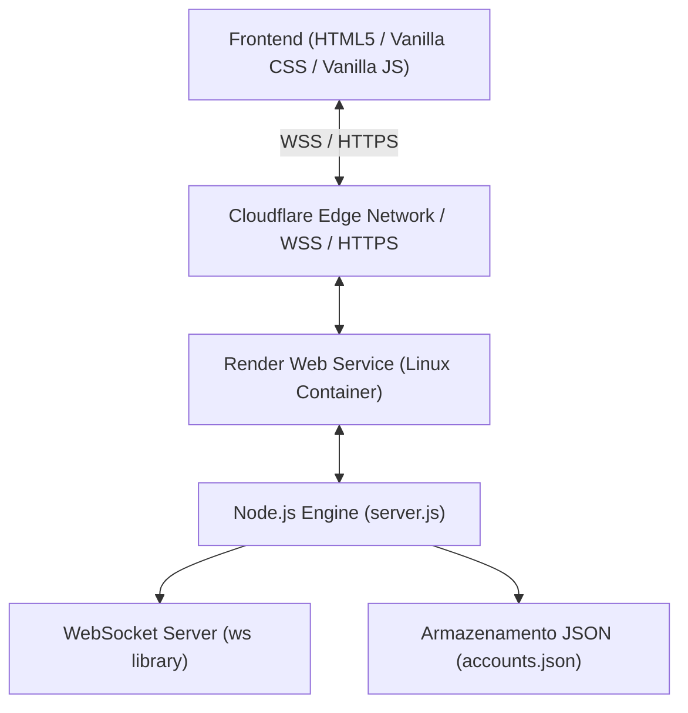
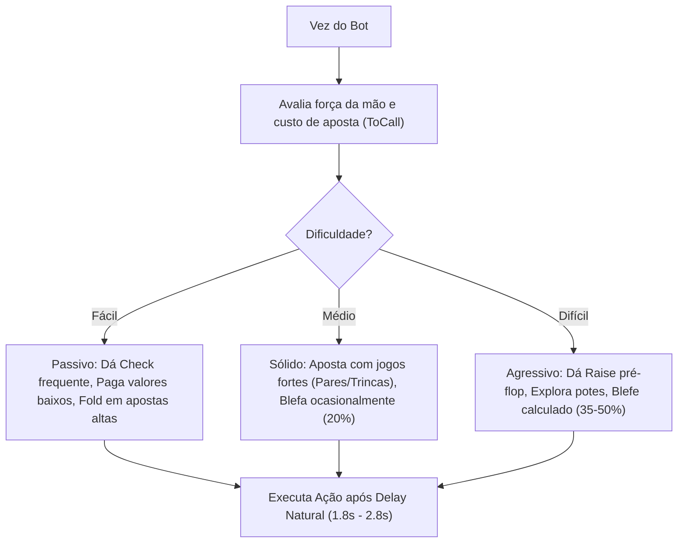
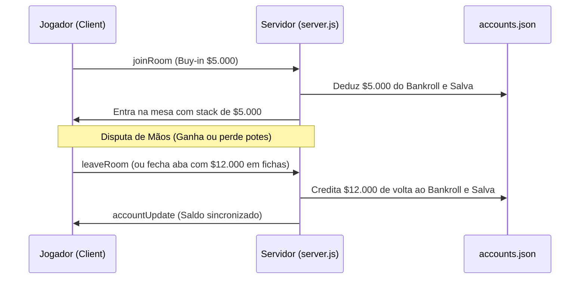

# Dossiê Oficial do Projeto MAXpoker

> **Data de Emissão:** 16 de Novembro de 2026  
> **Versão do Sistema:** 1.2.0  
> **URL de Produção:** [https://maxpoker.onrender.com](https://maxpoker.onrender.com)  
> **Repositório Oficial:** [https://github.com/jarvismorato/maxpoker](https://github.com/jarvismorato/maxpoker)  
> **Ambiente Local:** `C:\Users\gcava\.gemini\antigravity\scratch\simple-poker`

---

## 1. Visão Geral e Objetivo

O **MAXpoker** é uma aplicação completa de **No-Limit Texas Hold'em Poker** multiplayer em tempo real, desenvolvida com foco em simplicidade arquitetural, desempenho nativo, justiça estatística e experiência de usuário imersiva. 

O sistema suporta tanto partidas contra **outros jogadores humanos conectados simultaneamente** quanto contra **Bots Inteligentes (IA)** com diferentes níveis de habilidade e ritmos de aposta, capazes de preencher automaticamente mesas vazias.

---

## 2. Pilha Tecnológica (Tech Stack)

Para garantir máxima portabilidade, facilidade de manutenção e zero dependências pesadas de *build* ou frameworks de terceiros, o projeto adota arquitetura **Vanilla**:



- **Backend:** Node.js (v18+) utilizando módulos nativos (`http`, `crypto`, `fs`, `path`).
- **Comunicação em Tempo Real:** Biblioteca leve e rápida [`ws`](https://www.npmjs.com/package/ws) via WebSockets (RFC 6455).
- **Frontend:** HTML5 Semântico, CSS3 Moderno (Flexbox, CSS Grid, Animações 3D com aceleração por GPU), Vanilla JavaScript ES6+.
- **Efeitos Sonoros:** Síntese em tempo real através da **Web Audio API** nativa dos navegadores (sem arquivos pesados de áudio).
- **Hospedagem & Nuvem:** Render.com (Contêiner com deploy automático via Git), compatível com túneis Cloudflare (*cloudflared*).

---

## 3. Arquitetura do Sistema e Estrutura de Diretórios

```
simple-poker/
├── server.js               # Núcleo do servidor: regras, IA, baralho, contas e WS
├── accounts.json           # Banco de dados persistente de contas e saldos
├── package.json            # Metadados do projeto e dependências (ws)
├── package-lock.json       # Trava de versões de dependências
├── .gitignore              # Arquivos ignorados pelo Git (node_modules, binários)
├── iniciar-cloudflare.ps1  # Script PowerShell para túnel Cloudflare local
├── cloudflared.exe         # Binário portátil do Cloudflare Tunnel
├── DOSSIE_MAXPOKER.md      # Este documento completo de engenharia
└── public/                 # Arquivos públicos servidos ao cliente
    ├── index.html          # Estrutura das 3 telas: Login, Lobby e Mesa
    ├── style.css           # Design sóbrio, matte, cartas de cassino e animações
    └── client.js           # Gerenciamento de eventos WS, UI, sons e ações
```

---

## 4. Regras do Jogo e Motor de Poker

O motor do jogo foi construído estritamente sob as regras oficiais de torneios e *cash games* do **Texas Hold'em No-Limit (NLHE)**:

### 4.1. Estrutura da Mão e Estágios
1. **Preflop:** Dois blinds obrigatórios são postados (*Small Blind* e *Big Blind*). O baralho criptográfico é embaralhado e cada jogador ativo recebe 2 cartas de mão (*hole cards* viradas para baixo; o jogador vê as suas abertas).
2. **Flop:** 3 cartas comunitárias abertas no feltro. Rodada de apostas iniciada pelo jogador à esquerda do botão de Dealer.
3. **Turn:** 1 quarta carta comunitária revelada. Nova rodada de apostas.
4. **River:** 1 quinta e última carta comunitária revelada. Rodada final de apostas.
5. **Showdown:** Jogadores ativos que não deram fold revelam suas cartas. A melhor combinação de 5 cartas dentre as 7 disponíveis vence o pote.

### 4.2. Classificação Oficial de Mãos (Hierarquia de Força)
O algoritmo `getBestHand()` avalia matematicamente todas as 21 combinações possíveis de 5 cartas extraídas das 7 (2 da mão + 5 da mesa) e determina os desempates via *kicker*:

| Nível | Combinação | Descrição |
| :---: | :--- | :--- |
| **9** | **Straight Flush** | 5 cartas em sequência do mesmo naipe (inclui Royal Flush). |
| **8** | **Four of a Kind (Quadra)** | 4 cartas de mesmo valor numérico. |
| **7** | **Full House** | Uma trinca associada a um par. |
| **6** | **Flush** | 5 cartas quaisquer do mesmo naipe. |
| **5** | **Straight (Sequência)** | 5 cartas em ordem numérica consecutiva (Ás conta como 1 ou 14). |
| **4** | **Three of a Kind (Trinca)** | 3 cartas de mesmo valor numérico. |
| **3** | **Two Pair (Dois Pares)** | Dois pares de valores numéricos distintos. |
| **2** | **One Pair (Um Par)** | Duas cartas de mesmo valor numérico. |
| **1** | **High Card (Carta Alta)** | Maior carta individual para desempate. |

### 4.3. Regra Inviolável de Desistência (Fold)
- Ao selecionar **Fold**, as cartas do jogador são descartadas imediatamente do estado da mão (`seat.cards = []`).
- O assento permanece marcado com o rótulo permanente `Fold` durante toda a mão.
- Jogadores desistentes são **impossibilitados** de participar do *showdown*, de receber fichas ou de ser contemplados com o pote.
- Se restar apenas 1 jogador que não desistiu, a mão encerra instantaneamente sem necessidade de abrir novas cartas comunitárias.

---

## 5. Justiça Algorítmica e Baralho Criptográfico

Para garantir que a distribuição de cartas seja 100% neutra, imprevisível e imune a manipulações estatísticas:
- O baralho é composto exatamente pelas 52 cartas padrão (4 naipes: ♠, ♥, ♦, ♣; 13 valores: 2 a Ás).
- É utilizado o algoritmo de **Fisher-Yates** potencializado pelo gerador de números aleatórios criptográficos do sistema operacional (`crypto.randomInt` da biblioteca nativa `crypto` do Node.js), em vez do previsível `Math.random()`.

```javascript
function createCryptoShuffledDeck() {
  const deck = [];
  for (const s of SUITS) {
    for (const r of RANKS) {
      deck.push({ value: r.value, rank: r.label, label: r.label, suit: s.symbol, color: s.color });
    }
  }
  for (let i = deck.length - 1; i > 0; i--) {
    const j = crypto.randomInt(0, i + 1);
    [deck[i], deck[j]] = [deck[j], deck[i]];
  }
  return deck;
}
```

---

## 6. Inteligência Artificial dos Bots

O servidor conta com robôs autônomos com três perfis estratégicos distintos, capazes de simular o comportamento de jogadores reais:



- **Pausa Humana:** O bot não joga de forma instantânea. Um temporizador configurável (`getBotThinkingDelay`) faz com que o bot "pense" entre **0.9s e 2.8s**, permitindo que os jogadores humanos acompanhem a dinâmica da mesa sem sobrecarga visual.

---

## 7. Economia de Fichas e Persistência de Contas

### 7.1. Estrutura Financeira
- **Novas Contas Cadastradas:** Iniciam automaticamente com **$50.000 fichas**.
- **Bônus Periódico:** Um botão de resgate no cabeçalho concede **+$10.000 fichas** a cada **4 horas**. O servidor valida a estampa de tempo (`lastBonusClaim`), impedindo cliques repetidos ou alterações locais no navegador.
- **Conta Especial (Gabriel):** Configurada com privilégios VIP de **100 bilhões de fichas** ($100.000.000.000).

### 7.2. Buy-in Flexível e Ajustável
- Ao clicar em uma mesa, o jogador visualiza um modal com controle deslizante (*slider*) para escolher exatamente com quantas fichas deseja entrar na partida, respeitando o mínimo e o máximo da mesa e o saldo da sua carteira.

### 7.3. Ciclo de Vida e Salvamento de Fichas


---

## 8. Segurança e Protocolo WebSocket

A troca de mensagens utiliza pacotes JSON bidirecionais com validação estrita no servidor:

### Principais Tipos de Mensagens

| Direção | Mensagem (`type`) | Carga Útil (*Payload*) | Descrição |
| :--- | :--- | :--- | :--- |
| **C ➔ S** | `register` | `{ username, password, avatar }` | Criação de conta com senha criptografada em SHA-256 + Salt. |
| **C ➔ S** | `login` | `{ username, password }` | Autenticação por credenciais com retorno de token de sessão. |
| **C ➔ S** | `tokenAuth` | `{ token }` | Reconexão automática ao recarregar a página sem reabrir formulário. |
| **C ➔ S** | `joinRoom` | `{ roomId, buyInAmount }` | Entrada em mesa com buy-in personalizado. |
| **C ➔ S** | `action` | `{ action: 'fold'/'call'/'raise', amount }` | Execução de jogada na vez do assento ativo. |
| **C ➔ S** | `claimBonus` | `{}` | Reivindicação do bônus de 4 horas. |
| **S ➔ C** | `init` | `{ clientId, rooms }` | Inicialização de conexão e lista de mesas. |
| **S ➔ C** | `tableUpdate`| `{ table }` | Estado sanitizado da mesa (cartas adversárias mascaradas). |
| **S ➔ C** | `accountUpdate`| `{ account }` | Atualização do saldo total do jogador. |

> [!IMPORTANT]
> **Prevenção de Trapaças (*Sanitized State*):** A função `getSanitizedTable` nunca envia as cartas secretas dos adversários pelo WebSocket. Os adversários recebem apenas `{ hidden: true }`. As cartas só são enviadas para todos no momento do *showdown* e apenas para os jogadores que **não** desistiram da mão.

---

## 9. Design Visual e Experiência do Usuário (UI/UX)

- **Estilo Sóbrio e Matte:** A interface descarta cores fluorescentes e adota um padrão de cassino escuro refinado (`#0b0e14` e `#141821`), com bordas sutis e tipografia nítida.
- **Cartas Realistas:** Cartas brancas com textura plana, índices nos cantos opostos (com rotação de 180° no inferior direito) e naipes em vermelho escuro (`#b91c1c`) e carvão (`#18181b`).
- **Animações Fluidas:**
  - *dealSlideIn*: Animação de entrada suave das cartas ao serem distribuídas.
  - *cardFlipAnim*: Efeito tridimensional de virada ao revelar Flop, Turn e River.
  - *rotateDealerBtn*: Rotação de 360° do botão de Dealer ("D") ao mudar de assento.
  - *winner-banner*: Efeito de descida suave com troféu e detalhes da combinação vencedora.
- **Controles Intuitivos:** Botões de ação com peso visual equilibrado e slider com atalhos automáticos: *Mínimo*, *2x*, *3x*, *Pote* e *All-in*.

---

## 10. Guia de Operação e Comandos Úteis

### 10.1. Rodar Localmente
```powershell
cd C:\Users\gcava\.gemini\antigravity\scratch\simple-poker
npm install
node server.js
```
Acesse em: `http://localhost:3000`

### 10.2. Atualizar em Produção (Render)
Como o repositório está integrado por *Webhook* com o Render, qualquer atualização enviada para a branch `main` gera um deploy automático:
```powershell
git add .
git commit -m "Descrição das melhorias"
git push origin main
```

---

## 11. Conclusão

O **MAXpoker** atinge maturidade técnica completa: roda em qualquer dispositivo moderno sem necessidade de download ou instalação, suporta partidas simultâneas globais via nuvem com criptografia de ponta a ponta e entrega uma jogabilidade fluida, segura e justa de poker.
